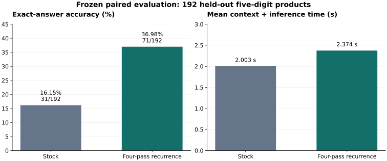

# Frozen-weight latent recurrence improves short-answer multiplication

**A model experiment on Qwen3.8 Flash Next UD-Q4_K_XL**

November 13, 2026

## Abstract

We modified inference in a frozen, quantized language model by applying one four-layer segment four times, with RMS matching between passes. No weights were trained or changed. On a frozen set of 192 held-out five-digit multiplication problems, exact complete-answer accuracy increased from **31/192 (16.15%) to 71/192 (36.98%)**. The gain was **20.83 percentage points**, with 49 corrections and 9 regressions on paired problems. Mean context-plus-inference latency increased from **2.003 to 2.374 seconds**, or **18.5%**. Both conditions used the same prompt, greedy decoding, generic integer grammar, and 32-token answer limit.

This result supports a specific claim: additional latent computation can improve exact arithmetic in this checkpoint under a short-answer constraint, without training. It does not establish a general reasoning improvement or superiority over unrestricted chain-of-thought. The branch includes the model implementation, complete per-problem results, task generator, scoring code, and reproduction harness. [Primary results](research/dory/model-study/confirmation27_score.json), [frozen design](research/dory/model-study/confirmation27_design.json), [per-problem comparison](research/dory/model-study/results.csv).



## 1. What changed in the model

The checkpoint has a 48-layer trunk. Stock inference applies each layer once. The selected modification repeats **zero-based layers 28 through 31 for four total passes**, during both prompt processing and answer generation. The surrounding layers still execute once. This produces 60 layer applications instead of 48: three additional applications of a four-layer block, a 25% increase in layer applications. That count is not a measurement of total FLOPs.

All passes share the original parameters. The modification introduces no new trained weights, adapter, external calculator, search over candidate answers, or target-dependent decoding. Experts are routed dynamically on each pass. The selected configuration does not pin experts, reinject the original activation, or blend the final result with the first-pass result. Its intervention is repeated application of the existing segment, with normalization and consistent temporal-state handling. [Model implementation](src/models/qwen4exp.cpp), [selected configuration](research/dory/config/loop.txt).

The architectural motivation is NVIDIA's Dory: spend additional inference computation by reapplying a shared block of layers. Dory is trained for recurrent computation. This experiment instead searches for a useful recurrence in an already-trained, frozen checkpoint; it does not reproduce Dory's training or normalized-GPT architecture. [Fishman et al., *Dory1.0-4B: A Looped Normalized-GPT*](https://arxiv.org/abs/2611.03998).

### 1.1 The selected recurrence

Let $x$ be the input to layers 28 through 31, $F$ their native transformation, and $a=F(x)$ the unmodified first-pass output. For each token and each hyper-connection stream, define RMS matching as

$$
N(z;r)=\frac{z}{\sqrt{\operatorname{mean}_d(z^2)+\epsilon}}
       \sqrt{\operatorname{mean}_d(r^2)}.
$$

The mean is over the embedding dimension and $\epsilon$ is the model's native normalization epsilon. The selected computation is

$$
h_1=N(a;a),\qquad
h_p=N\!\left(F\!\left(N(h_{p-1};x)\right);a\right),\quad p=2,3,4.
$$

The block's output is $h_4$. Input RMS matching keeps later-pass inputs near the original input magnitude; output RMS matching uses the first-pass output as its reference. This preserves reference magnitudes rather than imposing unit length. Because of epsilon, even $N(a;a)$ is not exactly an identity operation. The formula describes the activation update; $F$ also follows the state rules below.

The exact configuration is:

```text
28 31 4 1 0 0 2 0 0 0
```

| Field | Value | Meaning |
|---|---:|---|
| Start / end | 28 / 31 | Inclusive, zero-based layer window |
| Passes | 4 | Four total segment applications |
| Alpha | 1 | Full block update, without damping |
| Beta | 0 | No exit blend with the unmodified first output |
| Reinjection | 0 | No additive origin reinjection |
| Normalization | 2 | RMS match before later passes and after every pass |
| Mode | 0 | Repeat the whole segment |
| Scope | 0 | Apply to all tokens |
| Expert pinning | 0 | Recompute routes on each pass |
| Cache policy, omitted | 0 | Retain final-pass writes |

The implementation also supports other windows, one through eight total passes, per-layer repetition, damped updates, residual-update refinement, token scopes, route pinning, and first-pass cache retention. Those options formed the experimental search space. The headline result belongs to the one static configuration above. [Configuration parser and graph construction](src/models/qwen4exp.cpp).

### 1.2 Depth recurrence and temporal state

Repeating a layer is an extra computation at the same token position. It must not advance the recurrent model's temporal state as though extra tokens had arrived. Repeated Gated DeltaNet and convolution passes therefore read the same original previous-state snapshot. Each pass computes its current state, and attention uses that pass's current keys and values. Final-pass persistent writes survive for the next token.

An identity control executes the expanded graph but restores the unmodified first-pass hidden output and first-pass persistent cache writes. This checks that the added execution machinery can reproduce stock when the intervention is neutralized. In the original confirmation, first- and last-case controls matched complete generated token sequences, initial full-vocabulary logit fingerprints, and serialized state sizes and fingerprints. These controls validate execution semantics; they do not claim that active recurrence equals stock. [Control records](research/dory/model-study/confirmation27_controls.jsonl), [independent audit](research/dory/model-study/audit27_primary.json).

## 2. Choosing the recurrence

Development explored layer windows, pass counts, normalization, damping, reinjection, expert pinning, cache policies, and position-dependent schedules. Early likelihood screens were followed by full generated-answer tests. Correct prefixes used in teacher-forced likelihood screens were never supplied in the final accuracy evaluation.

The search produced substantial negative evidence. Wider loops could reduce accuracy; adding passes did not improve results monotonically; lower teacher-forced loss did not reliably predict exact complete-answer success. A narrow normalized segment became the candidate after these comparisons.

| Development comparison | Stock | Candidate | Interpretation |
|---|---:|---:|---|
| Wide block, layers 24 through 39, three passes, nine-digit product band | 42/96 | 21/96 | Wider recurrence substantially regressed |
| Raw block, layers 28 through 31, two passes | 3/48 | 8/48 | A narrow unnormalized loop showed an initial gain |
| Normalized block, layers 28 through 31, three passes | 3/48 | 9/48 | Normalization was promising |
| Normalized block, layers 28 through 31, four passes | 3/48 | 12/48 | Selected static candidate |
| Same block, six passes | 3/48 | 10/48 | Extra passes were not uniformly useful |
| Fresh 96-case replication, selected candidate | 22/96 | 44/96 | Supported proceeding to frozen confirmation |
| Basic language/instruction canaries | 40/40 | 40/40 | No failures on this small canary set |

The rows use different development sets where indicated and are not one common benchmark. Selection was extensive, so development comparisons and their unadjusted p-values are exploratory. They are not substitutes for held-out confirmation. [Development evidence](research/dory/model-study/development-summary.json), [96-case replication](research/dory/model-study/replication22_summary.json), [canaries](research/dory/model-study/regression26_summary.json).

## 3. Frozen benchmark protocol

### 3.1 Task distribution

Each task asks for the exact product of two independently generated five-digit integers. Each operand ends in 1, 3, 7, or 9. Products are not filtered by their value, number of digits, or model performance. Targets are checked using native integer multiplication and a separate decimal multiplication implementation. The held-out set uses a separate deterministic seed namespace and contains 192 problems. The recorded audit regenerated all cases and found no operand-pair overlap with 544 unique development pairs. [Generator](research/dory/model-study/integer_tasks.py), [decimal oracle](research/dory/model-study/math_tasks.py), [complete task set](research/dory/model-study/confirmation27_heldout192.jsonl), [audit](research/dory/model-study/audit27_primary.json).

The task is difficult for this model under the imposed response constraint: stock solves 16.15%. It is short enough for many paired experiments because the required answer is one integer. This is a generated arithmetic benchmark, not a standard broad reasoning suite.

The prompt has the form:

```text
Compute A x B. Return only the exact integer product, with no spaces, commas, or explanation.
```

The actual dataset uses the multiplication character U+00D7 in place of `x`; exact prompt text is preserved in the task file. No correct prefix or answer-length hint is supplied. Both primary conditions receive the same chat prefix with an already-closed thinking block, greedy decoding, a 32-token answer budget, and the task-independent grammar:

```text
root ::= [1-9] [0-9]* "\n"?
```

The grammar permits any positive integer, with an optional newline. It constrains output format without encoding a target value or length. Correctness requires the entire generated integer to match the independently computed product after trimming surrounding whitespace. There is no partial credit. All 384 primary completions terminated normally before the answer budget was exhausted. [Runner](research/dory/model-study/reproduce_recurrence.py), [scorer](research/dory/model-study/score_reproduction.py).

### 3.2 Design and statistical analysis

The recorded design froze one candidate, the task set, settings, runtime identities, scoring rules, and a success criterion before held-out inference. The criterion was an observed accuracy gain of at least 20 percentage points and an exact two-sided paired McNemar p-value below 0.01. The design prohibited optional stopping and configuration changes after launch.

Each task independently randomized which condition ran first, using the fixed order seed `paired-generation-v1`. Stock ran first on 90 tasks and recurrence on 102. Each request used a fresh context. One easy, unscored multiplication warmed each condition. The bootstrap confidence interval uses 10,000 paired resamples with seed 123456. [Frozen design](research/dory/model-study/confirmation27_design.json), [run manifest](research/dory/model-study/confirmation27_manifest.json), [primary analysis](research/dory/model-study/confirmation27_score.json).

The original efficacy experiment used CPU experts, 12 CPU threads, a 1,024-token context, and 512-token batches and microbatches. Both primary conditions disabled operation fusion, graph reuse, and CUDA graphs. The machine was an i9-13900K with 192 GB RAM and two RTX 5060 Ti 16 GB GPUs. The exact checkpoint's four shard sizes and SHA-256 hashes are supplied. [Hardware](research/dory/model-study/confirmation27_hardware.json), [model identity](research/dory/model-study/model_hashes.json).

## 4. Results

### 4.1 Primary held-out comparison

| Measure | Stock | Four-pass recurrence |
|---|---:|---:|
| Exact answers | 31/192 | 71/192 |
| Exact-answer accuracy | 16.15% | 36.98% |
| Valid, normally terminated completions | 192/192 | 192/192 |
| Mean context-plus-inference latency | 2.003 s | 2.374 s |
| Median context-plus-inference latency | 2.002 s | 2.367 s |

Recurrence produces **40 additional exact answers**, or **2.29 times as many correct answers**. There are 49 problems corrected by recurrence, 9 problems made incorrect, 22 solved by both, and 112 solved by neither. The absolute gain is **20.8333 percentage points**. Exact two-sided McNemar $p=8.9594\times10^{-8}$; the paired bootstrap 95% interval for the gain is **[14.0625, 28.1250] percentage points**. The observed result meets the frozen success criterion. The confidence interval does not establish that the population gain is at least 20 points. [Primary results](research/dory/model-study/confirmation27_score.json), [independent numerical rescore](research/dory/model-study/confirmation27_independent_rescore.json).

Mean latency rises by 0.371 seconds per problem, or 18.52%. Timing includes fresh context creation, state clearing, prompt processing, and complete answer generation. It excludes model loading and teardown. These are randomized, interleaved task timings, not token-throughput measurements.

A post-hoc answer-length breakdown places the net gain in ten-digit products: stock solves 16/160 and recurrence 56/160, with 45 corrections and 5 regressions. For nine-digit products, both solve 15/32, with 4 corrections and 4 regressions. These slices were not separately confirmed and should not be treated as prospective subgroup results. [Diagnostic breakdown](research/dory/model-study/confirmation27_diagnostics.json).

### 4.2 Stock and explicit-thinking controls

| Condition | Exact answers / 192 | Mean seconds | Status |
|---|---:|---:|---|
| Matched stock | 31 | 2.003 | Primary, interleaved |
| Four-pass recurrence | 71 | 2.374 | Primary, interleaved |
| Original runtime, fusion disabled | 31 | 2.008 | Separately run stock control |
| Original runtime, fusion enabled | 32 | 1.954 | Separately run stock control |
| Stock with 8 thought tokens | 3 | 2.446 | Timing-selected short-thought control |
| Stock with 4 thought tokens | 23 | 2.549 | Best short positive budget selected on development data |

The original runtime without fusion reproduced all 192 matched-stock generated token sequences and initial logit fingerprints. Compared with original fused stock, recurrence gains 20.31 percentage points, with 49 corrections and 10 regressions, exact paired $p=2.7063\times10^{-7}$. This comparison supports the gain relative to an original-runtime baseline as well as the matched primary baseline. Its latency comparison is descriptive because the runs were separate. [Secondary results](research/dory/model-study/confirmation27_secondary_score.json).

Short explicit-thinking budgets are weak controls: they can interrupt operand restatement and degrade answers. They also use an open thinking prefix and a separately decoded closing tag, so their prompting differs from the primary conditions. One four-token-control answer exhausted its final-answer cap and remained incorrect in the denominator. These conditions are not the basis of the headline result. [Control design](research/dory/model-study/confirmation27_control_design.json), [secondary validation note](research/dory/model-study/confirmation27_secondary_validation_note.json).

On a predetermined 16-case development subset, stock and recurrence both solved 9/16. Stock with a compact prompt and 256 thought tokens solved 12/16 at about 28.02 seconds per case, compared with about 2.42 seconds for recurrence. Every long thought reached its cap. The experiment therefore does not show that recurrence beats longer or unrestricted textual reasoning. [Subset design](research/dory/model-study/cost25_design.json), [long-thought results](research/dory/model-study/cost25long_stock_thought256.jsonl).

### 4.3 Runtime throughput after server integration

The same selected recurrence was subsequently integrated into the optimized local `llama-server` branch. A separate throughput comparison held the recurrence configuration fixed and switched operation fusion, graph reuse, and CUDA graphs off versus on. After a 4,095-token prefill and 64-token warmup, three paired 256-token generation requests measured:

| Trial | Optimizations disabled | Optimizations enabled |
|---|---:|---:|
| 1 | 9.8345 tokens/s | 19.9638 tokens/s |
| 2 | 9.8648 tokens/s | 20.5827 tokens/s |
| 3 | 9.8162 tokens/s | 20.7602 tokens/s |
| Median | **9.8345 tokens/s** | **20.5827 tokens/s** |

The median throughput ratio is **2.0929**, with matching generated token sequences in all three pairs. This measures execution speed for recurrent inference. It is separate from the stock-versus-recurrence accuracy experiment and does not measure a speed advantage from adding recurrence. The final packaged server configuration measured 20.17 tokens/s median in another three 256-token runs. [Throughput evidence](research/dory/evidence/graphs-summary.json), [final-package measurements](research/dory/evidence/memory-summary.json).

The 192-case accuracy result belongs to the original frozen evaluation runtime. It has not been rerun as a full efficacy benchmark on the later server package. Neutral-control equivalence and runtime validation support the integration, but they do not replace that missing accuracy rerun.

## 5. Interpretation and limits

The observations are consistent with a useful computation already present in the selected pretrained layers becoming more effective when applied repeatedly with controlled activation magnitudes. That is an interpretation, not an identified internal algorithm. We did not establish a fixed point, convergence guarantee, carry-propagation mechanism, or a universal rule for choosing recurrent layers.

The supported claim is narrow but substantial: on this quantized checkpoint, this generated multiplication distribution, and this constrained short-answer protocol, the selected recurrence improves exact accuracy by 20.83 points at an 18.5% mean latency cost. The following limits matter:

- The candidate was selected after extensive development search. Only the frozen 192-case comparison is the primary confirmation.
- The evidence covers one checkpoint and quantization. Independent checkpoints, hardware, and task distributions were not established.
- The generic integer grammar and closed-thinking prompt are part of the evaluation. Open-ended chat and unrestricted reasoning may behave differently.
- Forty basic canaries do not establish preservation of general language, coding, or instruction-following ability.
- Individual cases regress, and wider loops can reduce accuracy substantially. Four passes are a measured choice, not a universal optimum.
- Long-context capability, concurrent sequences, and cross-platform numerical identity are outside the model-efficacy result.
- Published artifact hashes support identity and reproducible reanalysis. They do not independently prove historical execution order.

## 6. Reproduction and branch contents

### Recompute the primary result without a GPU

With Python 3.10 or newer and NumPy already available, run from the repository root:

```powershell
python research/dory/model-study/score_reproduction.py `
  --tasks research/dory/model-study/confirmation27_heldout192.jsonl `
  --stock research/dory/model-study/confirmation27_stock.jsonl `
  --candidate research/dory/model-study/confirmation27_norm28_31x4.jsonl `
  --output primary-rescore.json
```

The scorer requires a new output filename, checks task identity, prompt hashes, configuration, grammar, termination, and exact answers, then recomputes the paired counts, p-value, confidence interval, and timings. It does not require model weights or binaries and makes no new claim about historical runtime provenance.

### Run a new model comparison

The [reproduction guide](research/dory/model-study/REPRODUCTION.md) describes the original source base, patches, harness build, and evaluation commands. The standalone runner accepts explicit executable, model, task, and output paths; verifies all four model shards; runs neutralization controls; and evaluates both conditions with fresh contexts and randomized paired order. New results should be scored as a fresh comparison.

The branch's main source tree contains the later server integration on base `97fdd5a3fa0eb4f298280abdc9a833c2be941035`. The original efficacy runtime was based on `6b46b979bea3d7b08e21a9f540d61503c7a84ac9`; its model patch and prerequisite patch are preserved separately. These source bases and runtime identities are deliberately distinguished. The existing optimized branch's streaming and decode work was inherited, rather than created by this recurrence experiment. [Provenance](research/dory/evidence/provenance.json).

| Material | Location |
|---|---|
| Model implementation | [qwen4exp.cpp](src/models/qwen4exp.cpp) |
| Selected and control configurations | [config](research/dory/config) |
| All primary tasks, outputs, and analysis | [model-study](research/dory/model-study) |
| Per-problem comparison | [results.csv](research/dory/model-study/results.csv) |
| Portable evaluation runner | [reproduce_recurrence.py](research/dory/model-study/reproduce_recurrence.py) |
| Evaluation harness source | [latent_eval_schedule.cpp](research/dory/model-study/latent_eval_schedule.cpp) |
| Parameterized server launcher | [launch.ps1](research/dory/launch.ps1) |
| Additional runtime evidence and regressions | [research/dory](research/dory) |

Model weights, runtime binaries, private chat templates, prior conversations, and raw diagnostic logs are not included. The paper was prepared from implementation files and structured experimental artifacts. Codex assisted the implementation, experimentation, analysis, and manuscript preparation.
